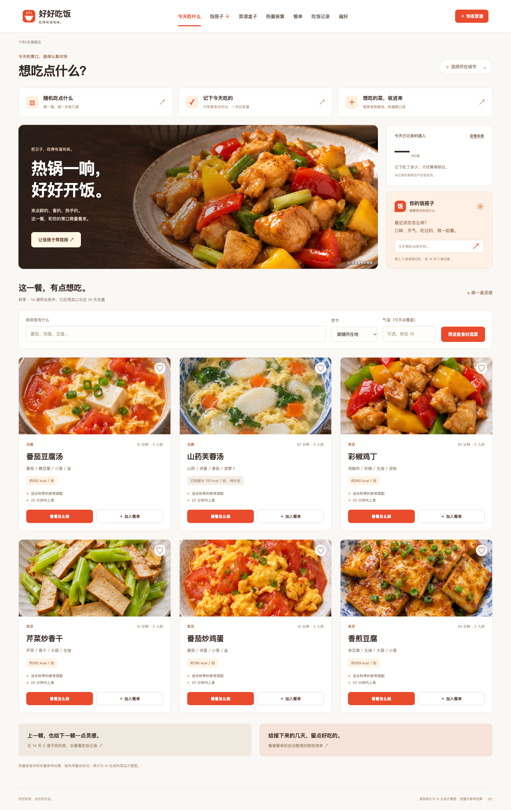
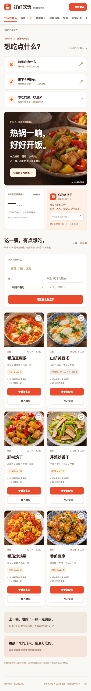
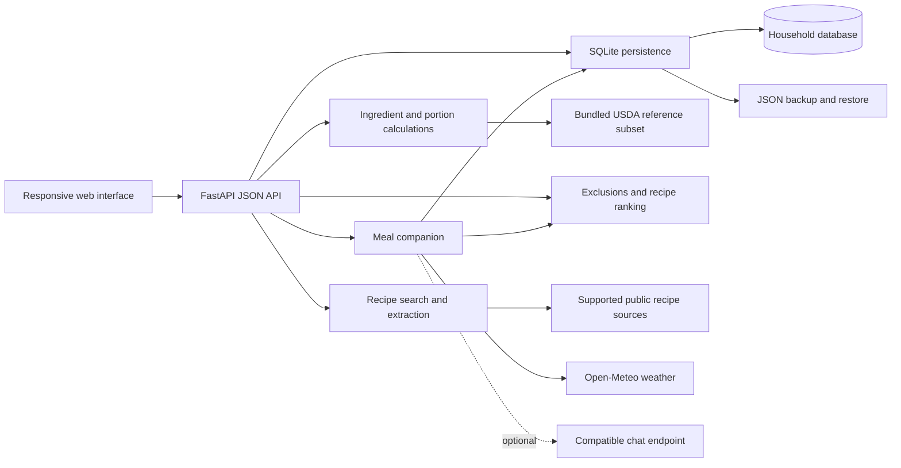

# HealthRecipe

HealthRecipe is a local-first recipe and meal-planning application for home cooking. Collect recipes, decide what to eat, record meals and estimate nutrition from ingredients and portions. An optional meal companion brings together recent meals, personal preferences, seasons and local weather to help plan the next few days.

The application uses Python, FastAPI and SQLite, with a responsive HTML, CSS and JavaScript interface. The current interface and meal companion use Simplified Chinese. This README is in English.

## Quick start

Install Python 3.11 or later and [uv](https://docs.astral.sh/uv/). From the repository root, run the following commands.

```sh
uv sync --frozen
uv run uvicorn src.app:app --host 127.0.0.1 --port 8000
```

Open [http://127.0.0.1:8000](http://127.0.0.1:8000). The first run creates the database and adds 16 editable sample recipes. Deleted samples stay deleted after a restart. The frontend requires no build step.

To start with an empty recipe collection, run this command before starting the application for the first time.

```sh
uv run python -m src.cli init --no-demo
```

| Setting | Default |
| --- | --- |
| HTTP address | `127.0.0.1:8000`, set through the Uvicorn command |
| `HEALTHRECIPE_DB` | `data/healthrecipe.db`, relative to the project root |
| Chat model | Local selection mode until a provider is configured |
| API documentation | `/docs` and `/openapi.json` |
| Health endpoint | `/api/health` |

An alternative installation using pip is also available.

```sh
python3 -m venv .venv
source .venv/bin/activate
pip install -r requirements.txt
python -m uvicorn src.app:app --host 127.0.0.1 --port 8000
```

## What you can try

| Workflow | Capabilities |
| --- | --- |
| Choose a meal | Browse, search and favorite recipes. Draw 1, 3 or 6 random dishes, with ingredient exclusions, cooking-time limits and recent-meal filtering. |
| Record what you ate | Enter one or several dish names, including takeaway and meals without recipes. Add a date, meal, portion and note, then edit or delete entries later. |
| Collect recipes | Type or dictate a method you know, search by dish name, or paste a supported recipe or share link. Compare sources, preview ingredients and steps, and confirm before saving. Keep unfinished ideas as drafts. |
| Talk through meal choices | Ask the meal companion for ideas using available recipes, recent meals, ratings, preferences, season and city weather. Confirm suggested dishes before adding them to a plan. |
| Manage food memories | Review, edit, expire or delete saved preferences, goals, habits and reported physical sensations. Temporary sensations default to 14 days. Explicit allergies have no automatic expiry. |
| Review nutrition | Estimate energy and macronutrients per serving, adjust edible weights and package-label values, and review recorded intake over the last 14 days. Incomplete estimates identify missing data. |
| Plan and shop | Build a seven-day meal plan and generate a shopping list. Ingredient amounts retain their original units to avoid combining incompatible quantities. |
| Keep your data | Store household data in SQLite and export or restore a portable JSON backup, including recipes, meal records, plans, chats, memories and drafts. |

### Recipe collection

Supported source adapters cover Xiachufang, Meishichina, Douguo, Xiaohongshu and The Woks of Life. Availability depends on the page and network. Login requirements, verification challenges and rate limits can prevent extraction. Public recipe text and structured recipe data are supported. Image-only and video-only instructions require manual input.

Search results retain source links. Select a version to fetch and preview it before saving. If a method is missing, the application offers another source, pasted text or a draft. Dictated methods preserve the original wording and are split into steps. Ingredients can be added later.

Voice input uses the browser's speech-recognition capability and may use the browser vendor's service. System dictation or typing is available when browser recognition is unsupported. Imported content retains its source attribution and remains subject to the source's terms and rights.

## Product showcase

Select an image to view it at full size. Food photographs are AI-generated illustrations of sample dishes. Nutrition is calculated from recipe data and portions.

| Desktop | Mobile |
| --- | --- |
| [](docs/screenshots/desktop-v3.png) | [](docs/screenshots/mobile-v3.png) |

## Architecture



| Layer | Implementation |
| --- | --- |
| Web interface | FastAPI serves the static files in `web/` and a same-origin JSON API. |
| Application | `src/app.py` exposes recipe, meal-log, planning, nutrition, memory and collection endpoints. Request models validate inputs. |
| Persistence | `src/storage/sqlite.py` manages SQLite migrations, foreign keys, WAL and transactional writes. Schema version 3 supports upgrades from earlier application databases. |
| Meal selection | `src/recommendation/recommend.py` applies exclusions and recent-history filters before ranking or random selection. Empty candidate sets keep the requested constraints. |
| Nutrition | `src/nutrition.py` calculates estimates locally from the bundled reference data. Meal entries preserve the nutrition snapshot recorded at the time. |
| Companion | `src/assistant.py` combines local context with an optional model. The server validates proposed recipe IDs and memory evidence. |
| Collection | `src/collection/web_recipes.py` searches supported sources and extracts public recipe data with bounded requests and restricted redirects. |

SQLite keeps deployment and backup lightweight for a single household instance. Search and ranking scan the recipe collection in memory, which suits small collections. Larger collections and sustained concurrent writes would need measured indexing and storage changes.

## Optional chat model

The default local mode provides recipe selection and limited record-based responses. Configure a compatible model for free-form conversation. Copy `.env.example` to `.env` and set the following values locally.

```dotenv
HEALTHRECIPE_LLM_PROVIDER=custom
HEALTHRECIPE_LLM_BASE_URL=https://your-provider.example/v1
HEALTHRECIPE_LLM_MODEL=your-model-name
HEALTHRECIPE_LLM_API_KEY=your-api-key
```

The endpoint must support `/chat/completions`, standard messages and `response_format` with `type` set to `json_object`. Set the base URL without `/chat/completions`. Remote endpoints require HTTPS. Local HTTP endpoints are limited to `localhost`, `127.0.0.1` and `::1`.

```sh
uv run --env-file .env uvicorn src.app:app --host 127.0.0.1 --port 8000
```

Credentials stay on the server. `.env` files are excluded from Git and the Docker build context. `GET /api/assistant/status` reports the active mode without returning credentials. Failed model requests fall back to local mode.

When configured, the model receives the current message, active memories, a recent-meal summary, candidate recipes and city weather. Previous chat transcripts are excluded from subsequent model requests. Memory can be disabled, and editing or deleting a memory clears chat context and retry caches. Weather requests use the city selected by the user, with a 30-minute cache and explicit unavailable states.

## Nutrition and data boundaries

The bundled nutrition reference contains 41 basic ingredients derived from USDA FoodData Central SR Legacy. Entries retain their original descriptions, FDC identifiers and source links. Energy is calculated from edible ingredient weights, then divided by recipe servings and multiplied by the portion actually eaten.

Unknown ingredients and unconvertible amounts are marked as missing from the estimate. Name-only meal records receive nutrition estimates only when linked to a matching recipe. Package-label energy can override reference energy, while missing macronutrients remain unknown. Editing a recipe does not rewrite earlier meal snapshots.

Intake totals cover recorded food only. Preferences and reported physical sensations support meal discussions, and the companion does not diagnose conditions or prescribe treatment. Ingredient-name filtering has limited coverage of compound ingredients and cross-contact.

All users of an instance share one household dataset. Authentication and member-level isolation are currently unimplemented. Keep the default loopback binding for local use. Public deployment requires authentication, HTTPS and an appropriate backup process. Backups contain private meal records, chats and memories.

## Storage and backups

Export and restore through the preferences screen or the CLI. Restore replaces the current dataset, so export a backup first. The export command refuses to overwrite an existing file.

```sh
uv run python -m src.cli backup /path/to/backup.json
uv run python -m src.cli restore /path/to/backup.json --replace
```

The current JSON format is version 3 and accepts version 1 and 2 backups. Restoration is transactional. HTTP uploads are limited to 10 MB. Use the CLI for larger files and place `--db /path/to/database.db` before the subcommand when selecting a database.

Legacy recipe arrays and Elasticsearch exports with `hits.hits[*]._source` can be imported separately.

```sh
uv run python -m src.cli import-recipes /path/to/legacy-recipes.json
```

Use JSON export or SQLite's backup API for a running instance. A raw copy of the main database file can omit changes in its WAL. Keep the database on local storage.

## Docker

```sh
docker compose up --build -d
```

Open [http://127.0.0.1:8000](http://127.0.0.1:8000). The container runs as a non-root user and persists data in the `recipe-data` named volume. Compose passes the generic model settings from `.env`. Removing the volume with `docker compose down -v` deletes its stored data.

## Development

Install development dependencies and run the checks from the repository root. Node.js is used for JavaScript syntax checks.

```sh
uv sync --frozen --dev
uv run pytest -q
uv run ruff check src scripts tests
uv run ruff format --check src scripts tests
node --check web/app.js
node --check web/companion.js
node --check web/quick.js
node --check web/api.js
docker compose config --quiet
```

GitHub Actions runs Python checks on Python 3.11, 3.12 and 3.13, plus JavaScript syntax checks. Tests cover persistence, API workflows, backups, nutrition, meal selection, memory handling and recipe extraction. Live source availability and device speech recognition need separate verification.

After changing dependencies, update the lockfile and pip requirements.

```sh
uv lock
uv export --no-dev --no-hashes --format requirements-txt --output-file requirements.txt
```

Implementation notes are available in Simplified Chinese for [architecture](docs/ARCHITECTURE.md), [the meal companion](docs/COMPANION.md), [quick entry and source support](docs/QUICK_ENTRY.md), [validation](docs/VALIDATION.md) and [visual assets](docs/VISUAL_ASSETS.md).

## License

The project is licensed under [Apache License 2.0](LICENSE). Imported recipes and third-party reference data retain their respective source rights and attribution requirements.
