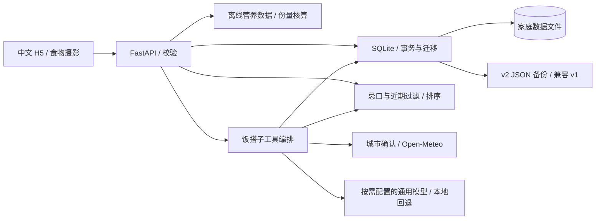

# 架构与取舍

v3 增加独立吃饭记录、随机入口和多来源菜谱快收；新增表与来源可用性见 [快捷入口说明](QUICK_ENTRY.md)。

## 为什么保持轻量

原型同时连接 Elasticsearch、MySQL、Neo4j，并下载 HanLP，但很多流程尚为空。当前个人／家庭数据规模下，一个 SQLite 足够容纳菜谱、食材关系、历史、餐单、偏好、聊天和记忆；部署与备份更简单。依据 [SQLite 官方适用范围](https://sqlite.org/whentouse.html)，多服务器或大量并发写入时再考虑 PostgreSQL。

- JSON 保存完整菜谱，关系表维护食材；日期和食材索引为后续查询优化保留空间。
- WAL、外键、短事务，连接按操作打开与关闭；10 秒忙等待。
- 搜索和候选评分仍采用内存扫描，适合当前小库；增长后先测性能，再考虑中文索引与 SQL 预筛。
- 模型只负责沟通与结构化候选，热量在本地计算，硬过滤在服务端执行，记忆证据与候选 ID 再校验。
- 真实天气与可选模型均有失败状态；天气断线不阻止记录、计算和选菜。

## 推荐保持可解释

先应用忌口／常见食材组、烹饪时长、最近 N 天去重（默认今天及前 13 天），显式填入食材时至少匹配一种。没有候选不擅自放宽约束。

现有食材命中比例 0–40 分，季节 +15，收藏 +8，历次评分均值 `(均分−3)×8`，当前实况气温与清爽／热汤标签相符 +12，20 分钟内 +5。同分按菜谱 ID 排序；随机模式保持相同硬过滤。所在地在南半球时反转季节。

身体感受不是疾病诊断，也不会自动转换为治疗饮食限制。明确的个人偏好与过敏声明才用于食材过滤；仍需核查真实复合配料和交叉接触。详情见 [助手与记忆设计](COMPANION.md)。

## 已补齐的原型问题

- 三套数据库不一致的索引、空推荐／历史接口，统一为可运行的持久化与选菜流程。
- 原分类每轮覆盖 `items`，修复为完整数组并重建原 HTML 快照。
- 绝对 XPath、无超时和 import 即读写文件，改为结构化数据优先、显式调用与有界网络请求。
- 原 ES 批量写入格式与单条空对象问题，改为 SQLite 兼容层和正式导入 CLI。
- v2 增加真实天气、热量核算、实际食用份量、营养快照、聊天与可管理记忆；前端换为食物特写与横向导航。

## 下一步优化

| 优先级 | 方向 | 触发条件 |
| --- | --- | --- |
| P1 | 用户选择并配置模型服务 | 当前已提供通用接口，遵从用户选择，稍后配置 |
| P1 | 个人／家庭成员账号和权限 | 多人分别记录身体感受，或需要公网部署前 |
| P1 | 扩充审核过的本地营养映射、品牌标签与可食克重 | 真实录入菜谱增长，减少「未计入」与代理食材 |
| P1 | 自有菜品照片上传、压缩和缩略图 | 当前示意图为 AI 生成，实际做菜照片更有个性 |
| P1 | 周期备份及恢复演练 | 长期使用；本次未擅自创建自动化计划 |
| P2 | 真正的多人份量缩放、兼容单位换算与库存扣减 | 确认家庭人数与计量规则后，避免错误合并用量 |
| P2 | 多样性、近期评价衰减和采纳率 | 有足够真实记录后，根据反馈而非猜测调权 |
| P2 | 降低食物素材体积、候选检索与摘要裁剪 | 外网／移动部署前测量首屏体积与模型上下文成本 |
| P3 | 微信小程序、通知等独立客户端 | H5 习惯稳定且有平台账号与服务配置后 |

当前家庭共用、默认本机访问，没有个人权限隔离。公网之前先补认证、HTTPS 和备份运维。Docker 配置已校验，但本机 daemon 未运行，尚未实际构建。
